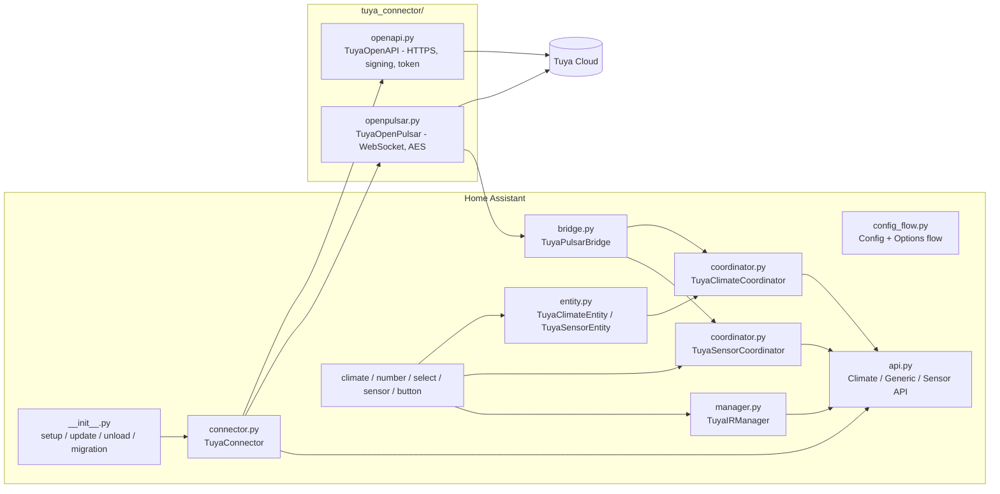

# Architecture

Internal design notes for contributors. Users do not need this page.

← Back to [README](../README.md)

---

## Overview

| Module | Responsibility |
|--------|----------------|
| `__init__.py` | `async_setup` (YAML import), `async_setup_entry`, `async_update_entry` (options listener), `async_unload_entry`, legacy entry migration |
| `config_flow.py` | Hub config flow (`user`, `reauth`, `import`) and the options flow (menus, device add/edit/remove, global presets, hub settings) |
| `connector.py` | Creates the OpenAPI client, the optional Pulsar client + bridge, and the three API wrappers. Raises `ConfigEntryNotReady` / `ConfigEntryAuthFailed`. Runs the Pulsar health check. |
| `api.py` | Thin wrappers around Tuya endpoints. They always return a `TuyaAPIResult` and never raise. |
| `bridge.py` | Dispatches decrypted Pulsar messages to handlers registered per `devId` |
| `coordinator.py` | `DataUpdateCoordinator`s for ACs (batch poll + commands + optimistic updates) and sensors (smart polling) |
| `manager.py` | Generic IR remotes: key list fetch and key send |
| `entity.py` | Shared logic for all AC entities (rules described in [climate-behavior.md](climate-behavior.md)) and for sensor entities |
| `models.py` | Frozen dataclasses: `RuntimeData`, `TuyaAPIResult`, `TuyaClimateData`, `TuyaGenericData`, `TuyaSensorData` |
| `helpers.py` | Tuya ↔ HA value mapping, unit conversion, preset merge |
| `const.py` | Keys, defaults, endpoints, Tuya code maps |
| `tuya_connector/` | Vendored and modernized async Tuya SDK (aiohttp). The logger is `custom_components.tuya_connector`. |

## Data model

One **config entry = one hub = one Tuya cloud project**.

- `entry.data`: hub settings (`access_id`, `access_secret`, `country`, `enable_pulsar`, `climate_update_interval`, `sensor_update_interval`).
- `entry.options`:
  - `climates`: list of AC dicts (`infrared_id`, `device_id`, `name`, sensors, ranges, modes, `hvac_presets`, `optional_entities`, `compatibility_options` {…})
  - `generics`: list of `{infrared_id, device_id, name}`
  - `sensors`: list of `{device_id, name, sensor_types, temp_unit}`
  - `global_presets`: user overrides `{preset: {hvac_mode: {temp, fan}}}`, merged over `DEFAULT_GLOBAL_PRESETS` at runtime
- `entry.runtime_data` (`RuntimeData`): connector, coordinators, IR manager, `global_presets` (merged), `hvac_presets` (per-device default temperature/fan values, filled by the number/select entities and restored through `RestoreEntity`).

## Lifecycle

1. **Setup**: migrate legacy entries if needed → `TuyaConnector.async_setup_connections()` (login, optional Pulsar start) → create the coordinators and run their first refresh → build `RuntimeData` → forward platforms.
2. **Options change** (`async_update_entry`):
   - If the secret, endpoint or Pulsar flag changed → full `async_reload`.
   - Otherwise → remove all hub devices from the device registry, unload the platforms, rebuild `RuntimeData` (keeping the connector and coordinators), and forward the platforms again.
3. **Unload**: unload platforms → close the HTTP session and stop Pulsar.
4. **Auth failure** at setup → `ConfigEntryAuthFailed` → reauth flow (`hub_settings` step).

## Command path (AC)

`ClimateEntity` / `SelectEntity` / `NumberEntity` → `TuyaClimateEntity.async_handle_*` → `_async_dispatch_command` → coordinator:

| Coordinator method | Tuya endpoint |
|--------------------|---------------|
| `_send_power_command` | `POST /v2.0/infrareds/{ir}/air-conditioners/{ac}/command` with `{"code": "power", "value": "0/1"}` |
| `_send_combined_command` | `POST /v2.0/infrareds/{ir}/air-conditioners/{ac}/scenes/command` with `{"power": "1", "mode", "temp", "wind"}` |

After success, `_async_force_update_data` applies an optimistic update to `coordinator.data` and notifies listeners. On failure, `ServiceValidationError` is raised with a translation key (`climate_error_*`).

> The coordinator also has `async_set_temperature` / `async_set_fan_mode` / `async_turn_on_with_temperature` / `async_turn_on_with_fan_mode` (single-code commands). They are currently **not used** by the entities: every change goes through the scene command.

## Polling

| Coordinator | Endpoint | Failure behavior |
|-------------|----------|------------------|
| Climate | `GET /v1.0/cloud/rc/infrared/ac/status/batch?device_ids=…` (all ACs in one call) | Logs a warning and **returns the previous data** (entities stay available) |
| Sensor | `GET /v2.0/cloud/thing/{id}/shadow/properties` (per device, semaphore of 3) | Raises `UpdateFailed` (entities become unavailable) |

Timeout per refresh: 15 s.

### Smart polling for sensors

With Pulsar enabled, `TuyaSensorCoordinator` records a timestamp per device and per logical DP (`temp_current`, `humidity_value`, `battery_state`). On each refresh, a device is fetched only if one of its supported DPs has not been updated within `update_interval − 5 s`. Devices that report everything through Pulsar therefore cost no API calls.

## Pulsar

- WebSocket: `wss://mqe.<region>:8285/ws/v2/consumer/persistent/{access_id}/out/event/{access_id}-sub` (PROD topic), with username = Access ID and password derived from MD5 of the ID + secret.
- Payloads are AES-decrypted with the secret (bytes 8–24) and acknowledged. Messages are dispatched by `devId`.
- Reconnects with exponential backoff (1 s → 60 s), heartbeat every 30 s.
- `is_connected()` becomes true on the **first text message** received. `connector.async_check_pulsar_connection()` waits about 30 s plus up to 10 × 3 s, then creates a persistent notification if no message has arrived.

## Tuya value mapping

| Tuya | Home Assistant |
|------|----------------|
| mode `0/1/2/3/4/5` | `cool / heat / auto / fan_only / dry / off` |
| wind (fan) `0/1/2/3` | `auto / low / medium / high` |
| `temp_current` ×10 | °C/°F (divided by 10) |
| `battery_state high/middle/low` | 100 / 50 / 10 % |
| `temp_unit_convert c/f` | °C / °F |

## Legacy migration

Before the hub architecture, each device was its own config entry with `data.device_type` (`climate` / `generic` / `sensor`). On setup, if the hub options lack the `climates` / `generics` / `sensors` keys, `_async_migrate_old_entries` copies these entries into the hub options (mapping `extra_sensors` → `optional_entities`, the `temp_hvac_mode` / `fan_hvac_mode` booleans → `hvac_presets`), removes the old entries, and shows a notification.

## Translations

UI strings live in `translations/*.json`. `en.json` is the reference. Keys used in code are in `const.py` (`TRANSLATION_KEY_*`) and in the `translation_key` arguments of `ServiceValidationError`.

## CI

- `.github/workflows/validate.yml`: `hassfest`
- `.github/workflows/action.yml`: HACS validation
