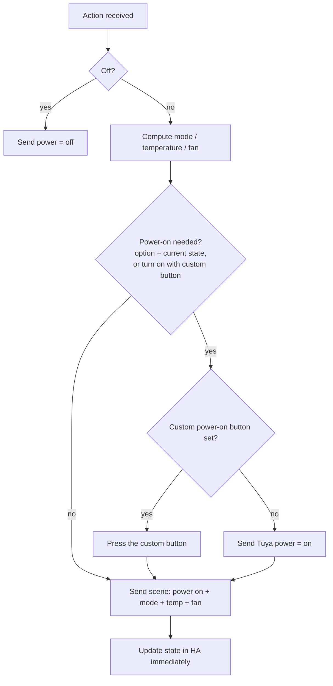

# How the climate entity behaves

An IR air conditioner cannot report its state, so the integration has to decide **what to send** for every action. This page lists those built-in rules. If your AC does something you did not expect, the explanation is probably here.

← Back to [README](../README.md)

- [Key facts](#key-facts)
- [What each action sends](#what-each-action-sends)
- [Target temperature rules](#target-temperature-rules)
- [Fan speed rules](#fan-speed-rules)
- [Power-on handling](#power-on-handling)
- [Presets](#presets)
- [Current temperature and humidity](#current-temperature-and-humidity)
- [How the state is kept in sync](#how-the-state-is-kept-in-sync)
- [Worked examples](#worked-examples)

---

## Key facts

1. **The integration never acts on its own.** It has no schedules, timers or thermostat logic. Every command comes from an action (service call) made in Home Assistant: a dashboard, an automation, a script, a voice assistant, HomeKit, and so on. The options only change **how** a command is built, never **when** it is sent. The single exception is the [Custom power-on button](configuration.md#compatibility-options), which this integration presses as part of a turn-on.
2. **Every change is sent as a complete state.** Changing the mode, temperature, fan or preset, or turning on, sends one Tuya *scene command* containing `power = on`, `mode`, `temperature` and `fan`. This is how real IR remotes work too: every key press transmits the whole state.
3. **Consequence: any change turns the AC on.** Setting the temperature, fan speed or a preset while the AC is off **turns it on** (in the last used mode).
4. **Turning off** sends a separate `power = off` command.
5. **Optimistic state.** When Tuya accepts a command, the new state is shown immediately. Tuya accepting the command does **not** prove that the AC received the infrared signal.

---

## What each action sends

| Action | Mode sent | Temperature sent | Fan sent | Power-on rule used |
|--------|-----------|------------------|----------|--------------------|
| **Turn on** (`climate.turn_on`, `homeassistant.turn_on`, toggle) | Last mode known by Tuya | Current target | Current fan | *hvac mode* rule, or **always** if a custom power-on button is set |
| **Turn off** / mode **Off** | (none) | (none) | (none) | Sends `power off` only |
| **Set HVAC mode** (not Off) | New mode | [Temperature rules](#target-temperature-rules) | [Fan rules](#fan-speed-rules) | *hvac mode* rule |
| **Set temperature** | Mode passed in the action, otherwise the last mode | Requested value | [Fan rules](#fan-speed-rules) | *temperature* rule |
| **Set fan mode** | Last mode | Current target | Requested fan | *fan speed* rule |
| **Set preset** (not None) | Current mode, or the last Cool/Heat mode if off | From the preset | From the preset | *hvac mode* rule |
| **Set preset** None | Nothing is sent | | | |

The *HVAC mode* select, *Fan speed* select and *Temperature* number ([optional entities](configuration.md#optional-entities)) run exactly the same code as the corresponding climate actions.

> "Last mode known by Tuya" is the mode stored in the Tuya cloud for that remote. While the AC is off, it still holds the mode used before turning off.

---

## Target temperature rules

Applied **only when switching HVAC mode** (not Off). The first rule that matches wins:

| # | Condition | Temperature sent |
|---|-----------|------------------|
| 1 | **Default temperature** is enabled and the new mode is Auto, Cool or Heat | Value of that mode's slider (*Auto* / *Cool* / *Heat*) |
| 2 | New mode is **Dry** and **Set minimum temperature in dry mode** is on | 16 °C |
| 3 | Current target is below **Minimum temperature** | Minimum temperature |
| 4 | Otherwise | Current target, unchanged |

*Set temperature* always sends the requested value. *Turn on* and *set fan mode* keep the current target.

## Fan speed rules

Applied when **switching HVAC mode** (not Off) **and when setting the temperature**:

| # | Condition | Fan sent |
|---|-----------|----------|
| 1 | Mode is **Dry** | **Low** if *Set minimum fan speed in dry mode* is on, otherwise **Auto** |
| 2 | **Default fan speed** is enabled | Value of the *Fan speed* configuration select |
| 3 | Otherwise | Current fan, unchanged |

> ⚠️ Because of rule 1 and rule 2, **changing the temperature can also change the fan speed**: in Dry mode the fan goes back to Auto/Low, and with *Default fan speed* enabled it goes back to the default. *Set fan mode* is the only action that always sends exactly the requested fan.

## Power-on handling

Some ACs ignore the "power on" contained in the scene command. For them, the integration can send a separate *power on* **before** the scene. Each action type has its own [compatibility option](configuration.md#compatibility-options):

| Action | Option used |
|--------|-------------|
| Turn on, set HVAC mode, set preset | *Force power on when setting hvac mode* |
| Set temperature | *Force power on when setting temperature* |
| Set fan mode | *Force power on when setting fan speed* |

| Option value | AC shown as **off** in HA | AC shown as **on** in HA |
|--------------|---------------------------|--------------------------|
| Never (default) | scene only | scene only |
| Always | power on → scene | power on → scene |
| Only if turned off | power on → scene | scene only |

**Custom power-on button.** If it is set:

- **Turn on** always presses the button, then sends the scene.
- For the other actions, whenever the table above says "power on", the integration presses the button **instead of** sending Tuya's power command, and then sends the scene.

---

## Presets

Presets (Home, Sleep, Eco, Comfort, Away) are pairs of **temperature + fan speed** defined per hub in [Global presets](configuration.md#global-presets), separately for **Cool** and **Heat**.

**Which presets are offered:**

- Only the presets selected in the AC's *Supported preset modes*, plus **None**.
- Only presets that have values for the current mode. In practice, presets are offered in Cool and Heat. In Auto, Dry and Fan only, the list contains only **None**.
- While the AC is off, the list is based on the **last Cool/Heat mode** seen since Home Assistant started.

**Selecting a preset:**

- Sends the preset's temperature and fan in the current mode. If the AC is off, it uses the last Cool/Heat mode and **turns the AC on**.
- Selecting **None** sends nothing.
- If the preset has no values for the current mode, nothing is sent.

**How the active preset is shown:** the preset is not stored. It is **recognized**: if the current target temperature **and** fan speed match the values of a preset for the current mode, that preset is shown. So:

- Changing the temperature or fan by hand makes the preset go back to **None**.
- Setting by hand a temperature and fan that match a preset makes that preset appear as active.
- When the AC is off, the preset is always **None**.

---

## Current temperature and humidity

- The climate's *current temperature* and *current humidity* come from the Home Assistant sensors chosen in the AC options. The temperature is converted to °C if needed.
- They update as soon as those sensors change.
- They are **informational**. The integration does not use them to switch the AC on or off. Use an [automation](examples.md) for that.

---

## How the state is kept in sync

| Source | When | What it updates |
|--------|------|-----------------|
| **Command from HA** | Immediately after Tuya accepts it | The values just sent (optimistic) |
| **Polling** | Every *Air conditioner update interval* (300 s by default) | All ACs of the hub, in one batch request |
| **Tuya Pulsar** (if enabled) | Within seconds | Changes made through Tuya, e.g. in the Smart Life app |
| **Physical remote** | Never | It is not detected. IR is one-way. |

- If a poll fails, the last known state is kept and a warning is logged. ACs do not become *unavailable*.
- After using the physical remote, Home Assistant and the AC disagree until the next command from HA (or from the app). Every command resends the full state, so the next one brings them back in line.

---

## Worked examples

Assume this configuration: modes Cool/Heat/Dry, **Default temperature** enabled (Cool 24 °C, Heat 22 °C), **Default fan speed** enabled (High), compatibility options at their defaults.

| Current state | Action | What is sent | Why |
|---------------|--------|--------------|-----|
| Off (last mode Heat, 22 °C, High) | `climate.turn_on` | power on, Heat, 22 °C, High | Turn on resends the last state |
| Heat 22 °C, Low | Set mode **Cool** | Cool, **24 °C**, **High** | Cool slider + default fan |
| Cool 24 °C, High | Set fan **Low** | Cool, 24 °C, Low | Fan change keeps everything else |
| Cool 24 °C, Low | Set temperature **23** | Cool, 23 °C, **High** | Default fan is re-applied on temperature changes |
| Cool 23 °C, High | Set mode **Dry** | Dry, 23 °C, **Auto** | Dry has no slider. Dry always uses fan Auto unless *minimum fan in dry* is on |
| Off (last mode Cool) | Set temperature **25** | power on, Cool, 25 °C, High | Any change turns the AC on |
| Off (last mode Cool) | Preset **Sleep** | power on, Cool, 27 °C, Low | Preset uses the last Cool/Heat mode |
| Heat 21 °C, Auto | (nothing) | | Shown preset: **Home**, because 21 °C + Auto match Home/Heat |

---

Next: [Automation examples](examples.md) · [Troubleshooting](troubleshooting.md)
